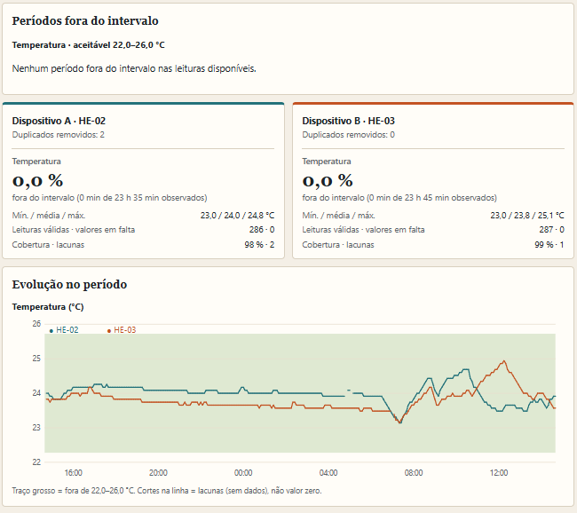
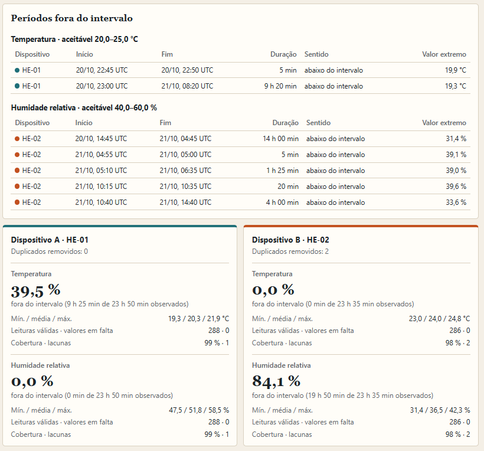
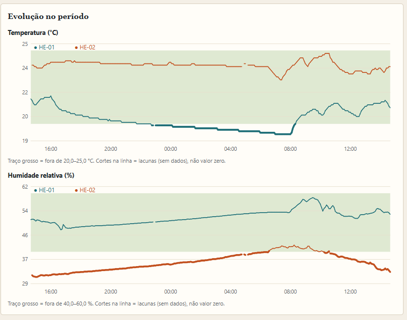
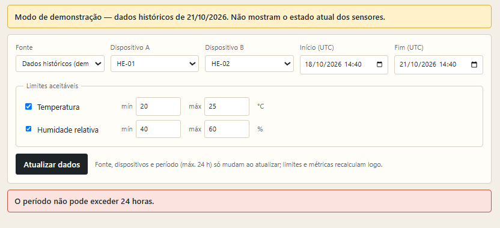

# Ambiente de trabalho: períodos fora do intervalo
**Utilizador e problema (cenário hipotético):** alguém que usa um espaço de trabalho com sensor e quer saber quando a temperatura e a humidade saíram do intervalo que definiu, e durante quanto tempo. Pode pôr dois dispositivos lado a lado para decidir qual merece atenção primeiro. A localização dos sensores não é conhecida nem assumida.

## Execução
Node.js ≥ 18, sem dependências.
```
npm start        # http://localhost:3000
npm test         # 7 testes automáticos
```
- **Com API:** copie `.env.example` para `.env` e preencha `HE_EMAIL` e `HE_PASSWORD`.
- **Sem credenciais:** arranca em "Modo de demonstração - dados históricos de 21/10/2026", com `data/DADOS_CONTINGENCIA_20261021.json`.

## Regra
O utilizador define mínimo e máximo para temperatura e/ou humidade. Cada leitura vale até à seguinte; um **período fora do intervalo** é uma sequência contínua de leituras abaixo do mínimo ou acima do máximo. Para cada período a app mostra início, fim, duração, sentido (abaixo/acima) e valor extremo. Se o intervalo entre leituras válidas for > 7,5 min é uma **lacuna**: não conta como dentro nem fora e corta o período. Por dispositivo e métrica há ainda a % do tempo observado fora, variação e cobertura. Na comparação, diferença < 5 pontos percentuais = "semelhante"; cobertura baixa ou desigual gera aviso.

**Interação:** mínimo, máximo e métricas recalculam logo; dispositivos, período (máx. 24 h) e fonte aplicam-se ao clicar "Atualizar dados".

## Dados
Origem, período, instante da consulta e última observação válida aparecem na página; o modo histórico diz sempre "dados históricos, não o estado atual". Campos: `si7021Temp`, `si7021Humidity`, instante `data.createdAt`. Timestamps repetidos: fica o `createdAt` exterior mais tardio e os removidos são contados. Nulos nunca viram 0. Falhas (API em baixo, login recusado, sem credenciais, resposta vazia) dão mensagem clara e oferecem os dados históricos (Modo de demonstração).

## Testes
| # | Entrada | Esperado | Obtido |
|---|---|---|---|
| 1. Normal | HE-02 vs HE-03, temp. 22–26 °C, 20/10 14:40 → 21/10 14:40 UTC | 2 duplicados removidos, 2 lacunas em HE-02, nenhum período fora |  |
| 2. Ativa a funcionalidade | HE-01 vs HE-02, temp. 20–25 °C e humidade 40–60 %, 20/10 14:40 → 21/10 14:40 UTC | HE-01: 565 min abaixo de 20 °C (39,5 %), HE-02: 0; humidade: HE-02 1190 min abaixo (84,1 %), HE-01: 0. Com mínimo de 17 °C a temperatura deixa de sair |     |
| 3. Falta/erro (**simulado**) | resposta vazia; só nulos; 1 leitura; lacuna de 30 min; quando a API estiver *down*; sem credenciais; janela > 24 h | «não significa dentro do intervalo»; lacuna não contada; `API_DOWN`; `NOT_CONFIGURED`; pedido recusado |   |

Esperados dos testes 1 e 2 calculados à parte, em Python, a partir do JSON. Os dados do teste 3 são simulados e identificados no código.

## Limitações
Sensores não calibrados nem auditados. Os limites são hipóteses didáticas, não normas de saúde ou segurança. A última leitura não tem duração própria. Não testei a API real (não estava funcionando, mesmo com as credenciais dadas pelo docente), só testado no Modo de Demonstração , mas só foram validados contra falhas simuladas.

## IA e código reutilizado
**IA:** usei o Claude para apoiar no desenvolvimento do código, que revi e executei. 

**Código reutilizado:** nenhuma biblioteca externa nem código copiado de
terceiros. Uso apenas funcionalidades do Node.js. O fluxo de acesso à API segue o guia do docente e os dados de demonstração são o ficheiro de contingência fornecido pelo docente.
## Versões
A versão demonstrada na aula: Versão 3. Versão da correções até à entrega: Versão 3
